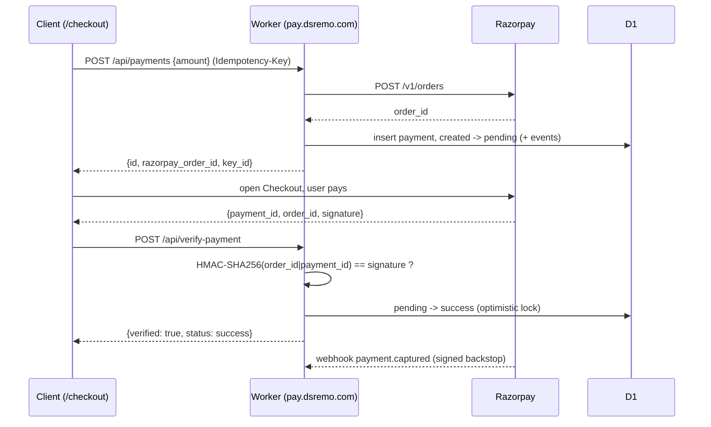
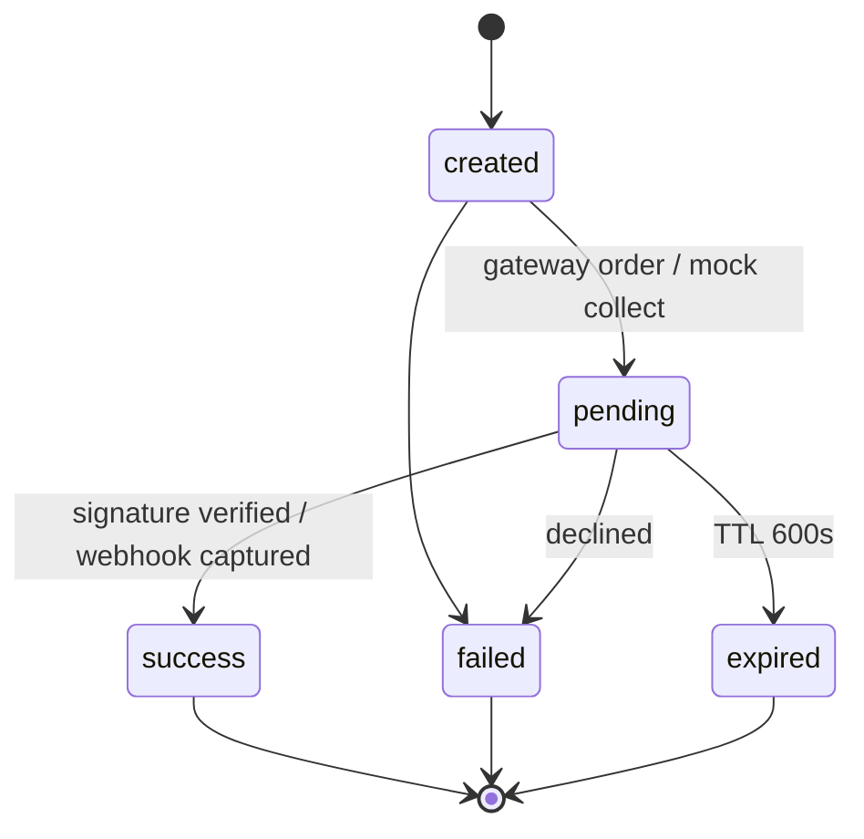

# UPI Payments Orchestrator

A small, original payment-orchestration service built UPI-first on **Cloudflare Workers + D1**.
It exposes a clean payments API with a server-enforced state machine, idempotent order
creation, HMAC-verified gateway callbacks, and a signed-webhook backstop. It runs with a
**keyless mock gateway** out of the box and switches to **real Razorpay** when credentials
are present — no code change.

**Live:** https://pay.dsremo.com · **Demo checkout:** https://pay.dsremo.com/checkout

> Proven end-to-end against the real Razorpay API (test mode): order creation → checkout →
> signature verification → state transition to `success`.

## Why it exists

Most "payment integration" demos stop at "open the gateway modal." This models the part that
actually matters in production: **idempotency, an enforced lifecycle, signature verification,
reconciliation, and an auditable event log** — the things that keep money state correct under
retries, races, and dropped clients.

## Architecture



## Payment lifecycle



Transitions are validated against an allow-list server-side; illegal jumps throw. Every
transition writes to a `payment_events` audit table.

## API

| Method & path | Purpose |
|---|---|
| `POST /api/payments` | Create a payment. `Idempotency-Key` header dedupes; same key returns the same payment. |
| `GET /api/payments/:id` | Status + full event history; reconciles a pending Razorpay payment against the gateway. |
| `POST /api/verify-payment` | Verify the checkout callback signature (`HMAC-SHA256(order_id\|payment_id)`); mismatch → 400, no state change. |
| `POST /api/webhook` | Gateway webhook; HMAC-SHA256 signature verified (timing-safe) before any state change. |
| `POST /api/payments/:id/refund` | Full or partial refund (`{ amount?, reason? }`, defaults to full); a guarded update prevents total refunds exceeding the captured amount, even under concurrent calls. |
| `GET /api/refunds/:id` | Refund status. |
| `POST /api/payments/:id/mock/{approve,decline}` | Drive the keyless mock provider (no gateway needed). |
| `GET /checkout` | Minimal demo checkout (Razorpay Checkout.js). |

## Design decisions

- **Idempotency** — `Idempotency-Key` maps to a unique column; a repeated key returns the
  original payment instead of creating a duplicate.
- **Optimistic locking** — every transition is `UPDATE … WHERE id = ? AND status = ?`; if the
  row already moved on, the update changes 0 rows and the transition is rejected. This makes a
  replayed webhook and a racing callback safe.
- **Two-layer confirmation** — the synchronous callback (`/verify-payment`) gives the user an
  instant result; the asynchronous **webhook** is the source of truth if the browser is closed
  mid-flow.
- **Pluggable provider** — `mock` (keyless, for local + demo) or `razorpay`, selected purely by
  whether `RAZORPAY_KEY_ID`/`RAZORPAY_KEY_SECRET` are set. No branching at the call sites.
- **Lazy expiry** — a stale `pending` payment transitions to `expired` on read, no cron needed.

## Roadmap — what a production version adds

This implements the correctness core (idempotency, lifecycle, verification, refunds, audit).
A production payment-orchestration platform layers on:

- **Multi-gateway routing** — an adapter per gateway (PayU, CCAvenue, BillDesk, Razorpay, …)
  behind a factory, plus a router that picks by method / cost / success-rate and **fails over**
  when one gateway is down. (Here the adapter seam exists — `mock` vs `razorpay`; the router is
  the next step.)
- **Split / marketplace settlement** — paying out a single collection to multiple parties.
- **Saga orchestration** — long-running, multi-step flows (e.g. auth → capture → settle →
  payout) modelled as a state machine with **compensating actions**, not a single request.
- **Versioned migrations + type-safe SQL** — instead of one `schema.sql`.
- **Scheduled reconciliation** — a cron worker matching local state against the gateway's
  settlement reports, not just reconcile-on-read.
- **Secret rotation** — per-merchant keys via a secret manager.
- **Disputes / chargebacks** — the lifecycle after a successful payment.

## Stack

Cloudflare Workers (no framework), D1 (SQLite), Web Crypto for HMAC. No payment SDK — the
gateway is reached over `fetch`, which keeps the Worker tiny and cold-start-free.

## Run it locally

```bash
nvm use 22
wrangler d1 execute upi-pay --local --file=./schema.sql
wrangler dev --local
# create -> mock collect -> approve
curl -s localhost:8787/api/payments -H 'content-type: application/json' -d '{"amount":14900}'
```

The mock provider needs no keys. To exercise the real Razorpay path, set `RAZORPAY_KEY_ID`,
`RAZORPAY_KEY_SECRET` (and `RAZORPAY_WEBHOOK_SECRET` for the webhook) as Worker secrets via
`wrangler secret put` — never in source. Amounts are in paise (minor units).
